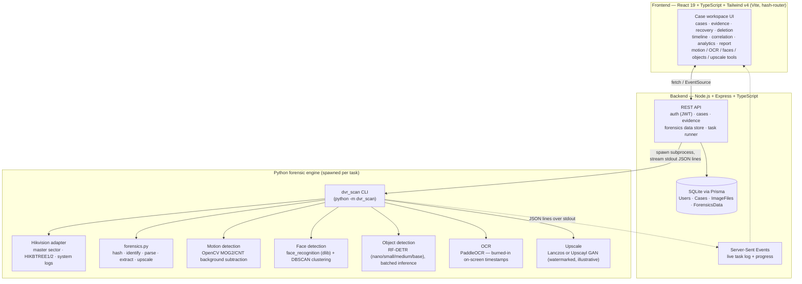

<p align="center">
  
</p>

<h1 align="center">Pramaan</h1>
<p align="center"><b>Vendor-agnostic DVR / NVR digital forensics platform</b><br/>
SIH 2026 · Problem Statement 150</p>

---

## Download

**Windows 10 / 11 (64-bit) installer:** [`Pramaan-Setup-0.5.2.exe` (1.15 GB)](https://github.com/Hetvi2509/SIH_PS_150/releases/download/v0.5.2/Pramaan-Setup-0.5.2.exe)

Everything runs on your computer, offline: no Python, Node or database to install, and the video, OCR,
face, object and upscaling tools are bundled. All releases: [Releases page](https://github.com/Hetvi2509/SIH_PS_150/releases).

1. Download the installer and run it. Windows SmartScreen may say "Windows protected your PC" because the
   installer is not code-signed: choose **More info → Run anyway**. Pick any drive; it needs about 5 GB.
2. On first launch, choose a folder for case data (database, evidence, recovered video), then **Sign up**.
   Accounts exist only on that computer.
3. Optional, for the **Sahayak** case assistant (chat button, bottom right): paste a free
   [Groq API key](https://console.groq.com/keys) into the panel once. It is stored in your data folder, never
   bundled in the installer. This is the only feature that uses the internet: your questions and the case
   details needed to answer them are sent to Groq. Without a key, nothing leaves your computer.

Verify the download (PowerShell): `Get-FileHash .\Pramaan-Setup-0.5.2.exe -Algorithm SHA256` should print

```
0dd5786a083d22d02f260a8f26c71a3ce17b85811beabeaa9cf6476f7b78546b
```

Windows N / KN editions need Microsoft's Media Feature Pack first. Pramaan analyses disk images; it does not
image a drive itself, so acquire the image first behind a hardware write blocker.

To run from source instead, see [Getting started](#7-getting-started).

---

## 1. What this is

CCTV DVRs/NVRs each store video in a different proprietary on-disk format (Hikvision, Dahua,
CP Plus, Honeywell, ...). An investigator who seizes one of these disks today needs a different,
often vendor-supplied tool per brand, with no standard way to recover deleted footage, normalise
timestamps across cameras, or produce a court-ready report with hash-verified chain of custody.

**Pramaan is one offline workstation that does all of it**, regardless of vendor:

1. **Image & hash** the disk (MD5 + SHA-256, hash-chained audit log).
2. **Identify** the vendor/family and **parse** its file system / index / logs.
3. **Recover** footage — live, deleted (from unallocated space), or repaired — per channel.
4. **Analyse** deletion patterns (formatted vs expired vs overwritten) and cross-check the
   recorder's logs against what the video itself shows.
5. **Normalise time** across cameras into UTC, with an explicit uncertainty (`± σ`) and which
   clock (recorder, OSD, logs, seizure photo) backs each timestamp.
6. Run **motion / face / object detection** on the recovered footage as investigative leads
   (never as identification).
7. Generate a **detailed, hash-verifiable PDF/JSON report** with a draft BSA 2023 §63(4)
   certificate, ready to hand to a court.

Everything runs **fully offline** — no evidence ever needs to leave the examiner's machine.

The full research plan, novelty claims and 10-week build schedule live in **[`plan.md`](plan.md)**;
this README documents the system as it is actually built.

---

## 2. Architecture



**Why a subprocess engine instead of one Node app:** the forensic/ML stack (OpenCV, PyTorch,
RF-DETR, dlib, PaddleOCR, pytsk3) is Python-only and heavy; Node.js owns the API, database and
auth, and shells out to the Python engine (`python -m dvr_scan <subcommand> ...`) per task. The
engine streams progress as newline-delimited JSON on stdout, which the backend re-emits to the
browser over **Server-Sent Events** so long-running tasks (parsing a multi-GB image, running
object detection on a video) show live progress instead of blocking the request.

### 2.1 Forensic pipeline (the "M0–M9" modules)

```
 INPUT                                                                        OUTPUT
 .E01/.dd/.img/.raw ─┐
 physical disk (WB) ─┴► M0 Intake ─► M1 Identify ─► M2 FS/Index parse ─┐
                        MD5+SHA256,    vendor,        allocated frames │
                        audit chain    model, disk    + logs           ▼
                                        M3 frame discovery / schema induction ──► Unified Frame Record
                                                                                  │
                  ┌───────────────────────────────┬───────────────────────────────┤
                  ▼                               ▼                               ▼
          M4 Recovery & reconstruction    M5 Deletion/anti-forensics      M6 Time normalisation
          per-channel MP4, live vs         type + format-time window,      UTC ± σ, witness
          deleted vs repaired              log↔video contradictions        provenance, tamper flags
                  ▼
          M4.5 Recovery validation — decode-check + quality gate
                  └───────────────┬───────────────┴───────────────┬───────────────┘
                                  ▼                               ▼
              M7 Analytics (motion / object / face, on passing clips)  M8 Clip manifests
                                  └───────────────┬───────────────┘
                                                  ▼
                                   M9 Report: PDF + JSON + BSA §63 draft
```

Every derived artefact (a clip, a detection, a timestamp) traces back through this chain to the
original disk image's hash — nothing is asserted without a way to re-derive it.

### 2.2 What's real vs. what's a fixture today

This is a hackathon-stage build, not a finished product, and the UI is honest about the
difference on-screen. To read the codebase the same way:

| Layer | Status |
|---|---|
| Auth, cases, evidence upload + hashing (M0) | **Real** — Express + Prisma + SQLite, exercised end to end |
| Hikvision parsing (master sector, HIKBTREE, logs) (M1/M2) | **Real** — `backend/engine/dvr_scan/hikvision/` |
| Motion / OCR / face / object detection / upscale (M7) | **Real** — actually spawns the Python engine and runs the models |
| Report generation (M9) | **Real** — pulls live case/evidence/forensics data, renders a print-ready PDF (browser print-to-PDF) + JSON, hash-stamped |
| Assistant (Sahayak) | **Real** — read-only tool-calling agent over the case database and the glossary; needs `GROQ_API_KEY` |
| Deletion analysis, timeline witnesses, cross-camera correlation, OEM comparison (M5/M6/M7-correlation) | **UI fixtures** (`frontend/src/lib/mock.ts`) — the screens, data shapes and interactions are built against `plan.md`'s spec so the real analysis can be wired in without changing the UI, but the numbers shown are illustrative, not computed |

---

## 3. Repository layout

```
SIH-2026-PS150/
├── plan.md                     # Full technical/research plan (modules M0–M10, novelty map, schedule)
├── pramaan_logo.jpeg           # Product logo (used as favicon + in-app logo)
├── frontend/                   # React + TypeScript SPA
│   ├── src/pages/              # One file per screen (overview, evidence, deletion, report, tool.tsx, ...)
│   ├── src/components/pramaan/ # App shell, sidebar, evidence workspace, report/log widgets
│   ├── src/components/ui/      # shadcn/Radix primitives
│   ├── src/lib/api.ts          # Typed fetch client + SSE subscriber for the backend
│   ├── src/lib/report.ts       # Report data assembly + printable HTML/JSON generation
│   ├── src/lib/mock.ts         # Fixture data for modules not yet wired to real analysis
│   ├── src/lib/chat.ts         # Assistant transport + the "what screen am I on" snapshot
│   └── src/components/pramaan/chat-widget.tsx  # Sahayak, the case assistant panel
│   └── DESIGN.md               # UI design language (theme, type, colour semantics)
├── backend/                    # Node.js API server
│   ├── src/index.ts            # Express routes: auth, cases, evidence, forensics, tasks, SSE
│   ├── src/engine.ts           # Spawns the Python engine, parses its JSON-lines protocol
│   ├── src/auth.ts, db.ts      # JWT auth, Prisma client
│   ├── src/chat/               # Sahayak: tool-calling loop, read-only lookups, glossary, prompt
│   ├── prisma/schema.prisma    # User / Case / ImageFile / ForensicsData models (SQLite)
│   └── engine/                 # The Python forensic engine (see below)
│       ├── dvr_scan/           # CLI entrypoint, Hikvision adapter, forensics.py, OCR, region editor
│       ├── criminal_detection/ # Face extraction + clustering (face_recognition + DBSCAN)
│       ├── object_detection/   # RF-DETR batched video inference
│       ├── paddle-ocr/         # OCR service for burned-in timestamps
│       └── upscayl-cli/        # Bundled GAN upscaling binary
├── notebooks/                  # Model evaluation notebooks (motion thresholds, object detection)
└── checkpoints/, scratch/      # Local experiment artefacts (git-ignored)
```

---

## 4. Tech stack

| Layer | Technology |
|---|---|
| Frontend | React 19, TypeScript, Vite, Tailwind CSS v4, shadcn/Radix UI, Phosphor icons, `react-router-dom` (hash router — Electron-ready) |
| Backend | Node.js, Express, TypeScript, Prisma ORM, SQLite, JWT auth (`jsonwebtoken` + `bcryptjs`), Server-Sent Events |
| Forensic engine | Python, OpenCV, PyAV/FFmpeg, `pytsk3` (file-system parsing), PyTorch + `rfdetr` (object detection), `face_recognition` (dlib) + scikit-learn DBSCAN (face clustering), PaddleOCR |
| Storage | SQLite (case/evidence metadata + audit trail), flat files on disk (evidence images, derived clips) |

---

## 5. How the pieces talk to each other

1. **Upload evidence** → `POST /api/cases/:id/images` streams the file to disk, hashes it
   (SHA-256) in one pass, and records an `ImageFile` + an `intake_hashes` `ForensicsData` row.
2. **Run an evidence action** (hash / identify / parse / extract) → `POST /api/images/:id/tasks/:action`
   spawns `python -m dvr_scan.forensics <action> --image <path> --work <dir>`, and the result is
   written back as another `ForensicsData` row keyed by `dataType` (e.g. `identification`,
   `parsed_bundle`, `integrity`). `GET /api/images/:id/forensics` returns everything computed for
   that image so far, as one JSON object.
3. **Run a video-analysis tool** (motion / OCR / faces / objects / upscale) → `POST /api/tasks/:kind`
   spawns the matching engine subcommand and returns a `taskId`; the frontend opens
   `GET /api/tasks/:id/stream` (SSE) and renders each JSON line as it arrives — log lines,
   progress updates, and a final `type: "*_complete"` event carrying the **exact output file
   path** the tool wrote (so the UI shows that tool's own result, not a guess from whatever else
   is in the shared output folder).
4. **Generate a report** → the frontend calls `GET /api/cases/:id`, `GET /api/cases/:id/images`
   and `GET /api/images/:id/forensics` for every image, combines that with the case's analysis
   data, computes a SHA-256 of the assembled report content, and renders a print-ready HTML
   document (the browser's own print-to-PDF is the PDF engine — no server-side PDF library) plus
   a downloadable JSON twin.

All of this is append-only from the database's point of view: nothing is silently overwritten,
and every write is attributable to the authenticated user.

---

## 6. API reference (backend)

| Method & path | Purpose |
|---|---|
| `POST /api/auth/signup`, `/api/auth/login` | Create an account / get a JWT |
| `GET/POST /api/cases`, `GET/DELETE /api/cases/:id` | Case CRUD (scoped to the authenticated user) |
| `GET/POST /api/cases/:id/images` | List / upload evidence images (hashed on upload) |
| `GET /api/images/:id/file` | Stream the raw evidence file |
| `GET/POST /api/images/:id/forensics` | Read/write the per-image forensic data store |
| `POST /api/images/:id/tasks/:action` | Run `hash \| identify \| parse \| extract` on one image |
| `POST /api/tasks/:kind` | Run `motion \| faces \| objects \| upscale` on an uploaded video/image |
| `POST /api/tasks/ocr` | Run OCR (synchronous for a single image, task-based for a video) |
| `POST /api/tasks/upscale-image` | Upscale a single image (Lanczos or Upscayl GAN) |
| `GET /api/tasks/:id/stream` | SSE stream of a running task's log/progress/result |
| `GET /api/outputs`, `/api/outputs/file` | List/serve files the engine wrote to an output directory (with on-the-fly transcode for browser preview) |
| `POST /api/uploads` | Generic file upload for tool inputs |
| `POST /api/chat/query` | Ask Sahayak a question about the case or a term (read-only; see §8) |

All routes except `/api/health` and auth require `Authorization: Bearer <token>`.

### Python engine CLI (`python -m dvr_scan ...`)

```
dvr_scan scan                        # Motion detection (DVR-Scan core)
dvr_scan forensics hash|identify|parse|extract|upscale --image X --work DIR
dvr_scan hikvision master|hikbtree|logs|extract|convert|parse-all
dvr_scan criminal-detection index|recognize <video> --output-dir DIR
dvr_scan object-detection --weights W --model {nano,small,medium,base} --video V --output O
dvr_scan ocr --image X | --video V --output O --sample-rate R --confidence C
dvr_scan upscale --image X --model M --output O
```

---

## 7. Getting started

### Prerequisites

- Node.js 20+
- Python 3.11 (a virtual environment at `backend/engine/.venv` is expected — see below)
- `ffmpeg` (a Windows binary is already vendored at `backend/engine/ffmpeg.exe`)

### 1. Backend

```bash
cd backend
npm install
npx prisma migrate deploy   # creates backend/prisma/app.db (SQLite)
npm run dev                 # http://localhost:4000
```

Set up the Python engine venv once (heavy ML deps — PyTorch, OpenCV, dlib, PaddleOCR):

```bash
cd backend/engine
python -m venv .venv
.venv\Scripts\pip install -r requirements.txt      # Windows
# or: .venv/bin/pip install -r requirements.txt     # macOS/Linux
```

Environment variables (all optional — sensible defaults are used if unset):

| Variable | Default | Purpose |
|---|---|---|
| `PORT` | `4000` | Backend HTTP port |
| `JWT_SECRET` | a dev-only fallback | **Set this in any real deployment** |
| `DATABASE_URL` | `file:./app.db` (from `schema.prisma`) | Override the SQLite location |
| `STORAGE_DIR` | `backend/` | Where `uploads/` and `outputs/` are written |
| `PYTHON_EXE` | `backend/engine/.venv/Scripts/python.exe` if present, else `python` | Override the Python interpreter used to spawn the engine |
| `GROQ_API_KEY` | unset | Enables the assistant. Without it `/api/chat/query` returns 503 and every other route is unaffected. Copy `backend/.env.example` to `backend/.env`. |
| `CHAT_MODELS` | `openai/gpt-oss-120b,qwen/qwen3.8-27b,openai/gpt-oss-20b,openai/gpt-oss-safeguard-20b` | Tried in order. Groq's free tier meters 8,000 tokens/minute *per model*, so each extra model is its own pool; a rate-limited model is skipped until its cooldown ends, and if all are limited the request waits up to 15 s before answering 503 with the real wait time |
| `CHAT_BASE_URL` | `https://api.groq.com/openai/v1` | Any OpenAI-compatible chat-completions endpoint |

### 2. Frontend

```bash
cd frontend
npm install
npm run dev                 # http://localhost:5173 (or next free port)
```

Set `VITE_API_URL` if the backend isn't on `http://localhost:4000`.

### 3. Use it

Open the frontend URL → sign up → create a case → add an evidence file → run the DVR-forensics
and video-analysis tools from the sidebar → generate a report from the **Report** page.

---

## 8. Notable engineering details

- **Every evidence file is hashed once on intake** (SHA-256, streamed — never loaded fully into
  memory) and every subsequent derived artefact keeps that hash as its provenance anchor.
- **Object detection is batched, not per-frame.** RF-DETR is traced once for a fixed batch size
  (`model.inference(compile=True, batch_size=4)`) instead of re-running eager inference on every
  frame — this alone cut a real test clip's processing time from ~2m26s to ~38s on CPU.
- **Each analysis tool reports the exact file it wrote** (`output_path` on its `*_complete`
  event), rather than the UI guessing "the newest file in the shared output folder" — the latter
  silently showed the wrong tool's result whenever two tools wrote to the same case directory in
  sequence.
- **The report is tamper-evident**: its own content is hashed (SHA-256, via `crypto.subtle` in
  the browser) and that hash is printed on the document itself, so a reader can tell if a copy
  was altered after export.
- **Nothing is silently skipped.** Sections of the report that depend on data not yet available
  (e.g. a missing seizure-time clock anchor) are listed as open items with a reason, not omitted.
- **The assistant cannot write, and not because it was asked not to.** Sahayak
  (`backend/src/chat/`) answers questions about the open case and explains the terminology on
  screen. It is a tool-calling loop over an OpenAI-compatible endpoint, and the tools it is given
  are six fixed Prisma reads plus a glossary lookup — there is no SQL surface and no write path,
  so a jailbroken model has nothing to reach for. `userId` is closed over from the verified JWT
  rather than being a tool argument, so it cannot ask for another examiner's case; that is
  exercised in both directions during testing. The screen snapshot the widget sends is only
  *context* (which tab is open, and what a fixture screen is showing) — every fact the assistant
  asserts about a case it reads from the database itself.
- **Fixtures are labelled to the model, not hidden from it.** The snapshot marks the illustrative
  screens as illustrative, and the system prompt requires the assistant to say so when it quotes
  one. The same rule applies to times without their sigma, and to face grouping, which it must
  present as a lead and never as an identification.
- **Each answer prints the lookups behind it.** The widget shows "From case record, glossary,
  parsed disk data" under the reply, so a claim in the chat can be traced the same way a number
  on a screen can.
- **The model list is a fallback chain, not a single model.** Groq returns 429 for the rest of
  the minute once a model's budget is spent; `CHAT_MODELS` is tried in order on a 429/5xx or a
  timeout, and only a non-capacity error (a 400, a bad tool schema) is raised straight through —
  retrying those elsewhere just repeats the same mistake.

---

## 9. Roadmap

See **[`plan.md`](plan.md)** for the full module list, novelty claims, validation protocol
against real multi-vendor disks, and the week-by-week build schedule toward the SIH Grand
Finale. In short: wire the remaining modules (M3 schema induction, M5 deletion analysis, M6
timeline normalisation, M7 triage/correlation) from UI fixtures to the real forensic engine, add
Dahua/CP Plus/Honeywell adapters alongside the existing Hikvision one, and validate everything
against real seized-and-imaged hardware rather than synthetic data.

## Windows desktop app

`Pramaan-Setup-0.5.0.exe` installs the whole platform as a Windows application that works offline: the web
interface, the backend, the forensic engine and the analysis models (OCR, face, object, motion, upscaling).

**Build** (see `desktop/`): freeze the engine with PyInstaller (`backend/engine/pramaan-engine.spec`), run
`ENGINE_BUILD=<engine folder> node desktop/stage.mjs`, then `electron-builder --win nsis`.

**Requirements**
- 64-bit Windows 10 or 11, about 5 GB free for the install, plus room for your case data.
- Windows **N / KN** editions need Microsoft's *Media Feature Pack* (the engine's OpenCV links Media Foundation).
- The optional *Upscayl (AI)* upscaling method needs a graphics driver with Vulkan support. The default Lanczos
  method works on any machine.
- The installer is not code-signed, so Windows SmartScreen shows a warning on first run.

**Where things go**
- The installer lets you choose the install folder (per-user or all users).
- On first launch the app asks where to keep case data (database, evidence, recovered video). Pick a folder on the
  drive with the most space. The app refuses a folder inside its own program folder, because **uninstalling deletes
  the program folder and everything in it**. If you cancel the prompt, data goes in a `Pramaan Data` folder next to
  the install folder.
- To reuse existing data after reinstalling, choose the same data folder again.
- Uninstalling leaves a data folder that is outside the program folder untouched.
