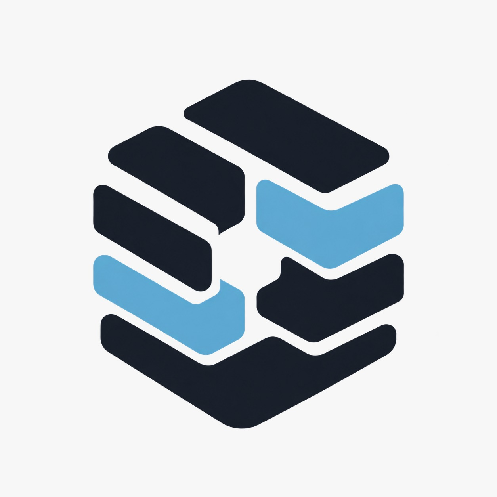
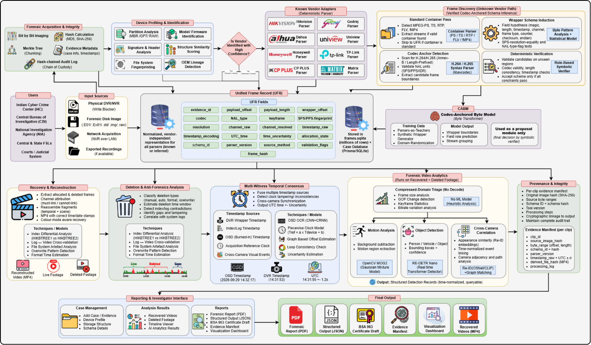
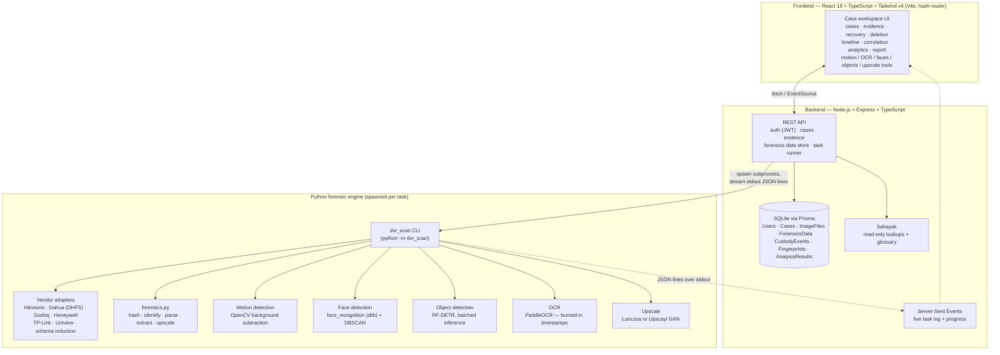

<p align="center">
  
</p>

<h1 align="center">Pramaan</h1>

<p align="center"><i>From "this DVR's disk looks empty" to recovered footage, a verified timeline, and a court-ready report — in one offline workstation.</i></p>

<p align="center">
  <b>A vendor-agnostic DVR / NVR digital-forensics platform</b> for investigators who need to recover, date and
  prove CCTV evidence from seized recorders — whatever the brand — with hash-verified chain of custody, built for
  <b>SIH 2026 · Problem Statement 150</b>.
</p>

<p align="center">
  
  
  
  
  
  
  
  
</p>

---

## 👥 Meet the Team

Built by a team of six. Every layer — the parsers, the models, the API, the database and the interface — was
designed, coded and tested by:

| | | |
|:--:|:--:|:--:|
| **Henit Panchal**<br/>Team Leader · Machine Learning · Backend | **Hetvi Hinsu**<br/>Backend | **Heny Patel**<br/>Machine Learning |
| **Mihir Patel**<br/>Machine Learning | **Aarav Shah**<br/>Frontend | **Dhwani Thakkar**<br/>Database Management |

---

## 📋 Table of Contents

1. [Download](#-download)
2. [Problem Statement](#-problem-statement)
3. [What Pramaan Does](#-what-pramaan-does)
4. [Architecture](#%EF%B8%8F-architecture)
5. [Libraries & Tech Stack](#%EF%B8%8F-libraries--tech-stack)
6. [Data Model](#%EF%B8%8F-data-model)
7. [Access Model](#-access-model)
8. [Complete User Workflow](#-complete-user-workflow)
9. [Screens & Features](#-screens--features)
10. [Project Structure](#-project-structure)
11. [Quick Start](#-quick-start)
12. [Environment Variables](#-environment-variables)
13. [End-to-End Demo Script](#-end-to-end-demo-script)
14. [Cross-Cutting Features](#%EF%B8%8F-cross-cutting-features)
15. [API Guide](#-api-guide)
16. [Windows Desktop App](#%EF%B8%8F-windows-desktop-app)
17. [Documentation](#-documentation)
18. [Build Status](#-build-status)

---

## 📥 Download

**Windows 10 / 11 (64-bit) installer:** [`Pramaan-Setup-0.5.2.exe` (1.15 GB)](https://github.com/Hetvi2509/SIH_PS_150/releases/download/v0.5.2/Pramaan-Setup-0.5.2.exe)

Everything runs on your computer, offline: no Python, Node or database to install, and the video, OCR, face, object
and upscaling tools are bundled. All releases: [Releases page](https://github.com/Hetvi2509/SIH_PS_150/releases).

1. Download the installer and run it. Windows SmartScreen may say "Windows protected your PC" because the
   installer is not code-signed: choose **More info → Run anyway**. Pick any drive; it needs about 5 GB.
2. On first launch, choose a folder for case data (database, evidence, recovered video), then **Sign up**.
   Accounts exist only on that computer.
3. Optional, for the **Sahayak** case assistant (chat button, bottom right): paste a free
   [Groq API key](https://console.groq.com/keys) into the panel once. It is stored in your data folder, never
   bundled in the installer. This is the only feature that uses the internet: your questions and the case
   details needed to answer them are sent to Groq. Without a key, nothing leaves your computer.

Verify the download (PowerShell): `Get-FileHash .\Pramaan-Setup-0.5.2.exe -Algorithm SHA256` should print

```
0dd5786a083d22d02f260a8f26c71a3ce17b85811beabeaa9cf6476f7b78546b
```

Windows N / KN editions need Microsoft's Media Feature Pack first. Pramaan analyses disk images; it does not image a
drive itself, so acquire the image first behind a hardware write blocker. To run from source instead, see
[Quick Start](#-quick-start).

---

## 🎯 Problem Statement

Every CCTV recorder stores video in its own proprietary on-disk format, and investigators face:

- 🔒 **A different tool per brand** — Hikvision, Dahua, CP Plus, Honeywell and others each use a different file
  system, index and timestamp scheme, usually with vendor-supplied software.
- 🗑️ **No standard way to recover deleted footage** — formatted or overwritten recorders look empty to Windows.
- 🕐 **Untrustworthy clocks** — recorder clocks are hand-set, drift, and are stored in vendor pseudo-epochs with no
  time zone, so timestamps across cameras cannot simply be compared.
- 📜 **Weak evidentiary trail** — no hash-verified chain of custody, and no ready path to the certificate Indian
  courts require for electronic evidence (Section 63, Bharatiya Sakshya Adhiniyam 2023).
- 🤖 **Detections presented as facts** — motion, face and object detection are leads, but are often reported as
  identification.

Pramaan digitises the whole workflow: image and hash the disk, identify the vendor, parse and recover, analyse
deletion, normalise time with explicit uncertainty, run analytics as leads, and produce a hash-verifiable report with a
draft Section 63 certificate — all on one machine, with nothing leaving it.

---

## ✨ What Pramaan Does

**One workstation. Every vendor. Nothing leaves the examiner's machine.**

| # | Module | What it does |
|:--:|---|---|
| M0 | **Intake** | Hashes the evidence (MD5 + SHA-256) in one streamed pass and opens a hash-chained audit log |
| M1 | **Identify** | Profiles the disk: partitions, signatures, file-system fingerprint, vendor/model scoring |
| M2 | **Parse** | Reads the vendor's file system, index and system logs (Hikvision master sector, HIKBTREE, logs, and more) |
| M3 | **Frame discovery** | Finds frames when no parser matches: container pass, codec-anchor detection, schema induction |
| M4 | **Recovery** | Extracts live, deleted and repaired footage per channel as MP4, with a decode-check quality gate (M4.5) |
| M5 | **Deletion analysis** | Classifies deletion (formatted, overwritten, expired) and cross-checks logs against video |
| M6 | **Time normalisation** | Converts recorder clocks to UTC with `± σ`, noting which clock backs each timestamp |
| M7 | **Analytics** | Motion, object and face detection on recovered clips; cross-camera correlation; OCR of burned-in time; upscaling |
| M8 | **Clip manifests** | Per-clip provenance: source offsets, hashes, parser version, processing log |
| M9 | **Report** | Hash-stamped PDF + JSON with a draft BSA 2023 §63 certificate |
| — | **Sahayak assistant** | Read-only chat assistant that explains forensic terminology and looks up case details |

---

## 🏗️ Architecture

### Pipeline Overview

<p align="center">
  
</p>

Evidence enters through **acquisition and integrity** (bit-for-bit image, MD5/SHA-256, Merkle tree, hash-chained audit
log), is **profiled** to pick a vendor, and is parsed either by a **known-vendor adapter** (deterministic) or the
**frame-discovery path** (container pass, codec anchors, wrapper-schema induction, verified deterministically). Both
produce one vendor-independent **Unified Frame Record**, from which recovery, deletion analysis, time consensus and
video analytics run in parallel, feeding provenance, case management and the final report.

### Runtime View



**Why a subprocess engine instead of one Node app:** the forensic/ML stack (OpenCV, PyTorch, RF-DETR, dlib,
PaddleOCR, pytsk3) is Python-only and heavy; Node.js owns the API, database and auth, and shells out to the Python
engine per task. The engine streams progress as newline-delimited JSON on stdout, which the backend re-emits to the
browser over **Server-Sent Events**, so long tasks (parsing a multi-GB image, running object detection on a video)
show live progress instead of blocking the request.

### Forensic Pipeline (M0–M9)

```
 INPUT                                                                        OUTPUT
 .E01/.dd/.img/.raw ─┐
 physical disk (WB) ─┴► M0 Intake ─► M1 Identify ─► M2 FS/Index parse ─┐
                        MD5+SHA256,    vendor,        allocated frames │
                        audit chain    model, disk    + logs           ▼
                                        M3 frame discovery / schema induction ──► Unified Frame Record
                                                                                  │
                  ┌───────────────────────────────┬───────────────────────────────┤
                  ▼                               ▼                               ▼
          M4 Recovery & reconstruction    M5 Deletion/anti-forensics      M6 Time normalisation
          per-channel MP4, live vs         type + format-time window,      UTC ± σ, witness
          deleted vs repaired              log↔video contradictions        provenance, tamper flags
                  ▼
          M4.5 Recovery validation — decode-check + quality gate
                  └───────────────┬───────────────┴───────────────┬───────────────┘
                                  ▼                               ▼
              M7 Analytics (motion / object / face, on passing clips)  M8 Clip manifests
                                  └───────────────┬───────────────┘
                                                  ▼
                                   M9 Report: PDF + JSON + BSA §63 draft
```

Every derived artefact (a clip, a detection, a timestamp) traces back through this chain to the original disk image's
hash — nothing is asserted without a way to re-derive it.

---

## 🛠️ Libraries & Tech Stack

### Frontend (`frontend/`)

| Technology | Purpose |
|---|---|
| **React 19** + **TypeScript** | UI and type safety |
| **Vite** | Build and dev server |
| **Tailwind CSS v4** | Styling |
| **shadcn/ui** + **Radix** | Accessible component primitives |
| **Phosphor icons** | Icon set |
| **react-router-dom** (hash router) | Routing that also works from `file://` inside Electron |
| **sonner** | Toast notifications |
| **date-fns**, **react-day-picker** | Dates |

### Backend (`backend/`)

| Technology | Purpose |
|---|---|
| **Node.js** + **Express** (TypeScript) | REST API |
| **Prisma** + **SQLite** | Case, evidence, forensic data, custody chain, knowledge base |
| **jsonwebtoken** + **bcryptjs** | Authentication |
| **multer** | Evidence and tool-input uploads |
| **Server-Sent Events** | Live task logs and progress |

### Forensic Engine (`backend/engine/`)

| Technology | Purpose |
|---|---|
| **Python 3.11** | Engine language (`python -m dvr_scan`) |
| **OpenCV**, **PyAV / FFmpeg** | Video decode, motion detection, remux |
| **pytsk3** | File-system parsing |
| **PyTorch** + **RF-DETR** | Object detection |
| **face_recognition (dlib)** + **scikit-learn DBSCAN** | Face detection and grouping |
| **PaddleOCR** | Burned-in on-screen timestamp reading |
| **Upscayl** / Lanczos | Optional image upscaling |
| **PyInstaller** | Freezes the engine for the desktop app |

### Desktop (`desktop/`)

| Technology | Purpose |
|---|---|
| **Electron** | Windows application shell running the backend in-process |
| **electron-builder (NSIS)** | Installer |

---

## 🗄️ Data Model

A small relational schema managed by Prisma (SQLite) — see [`backend/prisma/schema.prisma`](backend/prisma/schema.prisma).

```
User ──┬── Case ── ImageFile ── ForensicsData        (one row per image per data type)
       │     └──── AnalysisResult                    (motion / objects / faces per clip)
       ├── Fingerprint                               (per-user forensic knowledge base)
       └── (sessions are JWTs; accounts exist only on the local machine)

CustodyEvent  (append-only hash chain per case, deliberately unrelated to Case so it outlives it)
```

| Model | Description |
|---|---|
| **User** | Local account (username, email, hashed password, last login) |
| **Case** | One investigation, owned by one user |
| **ImageFile** | An evidence file in a case: name, path, SHA-256, size |
| **ForensicsData** | Everything the engine computed for an image, keyed by `dataType` (`intake_hashes`, `media_hashes`, `identification`, `parsed_bundle`, `extraction_<id>`, …) |
| **CustodyEvent** | Append-only chain of custody: sequence, time, actor, action, file, hash, previous hash, event hash |
| **Fingerprint** | Traits observed on past evidence (device vs unknown layouts), compared by Jaccard similarity with status `OBSERVED → CANDIDATE → VALIDATED / REJECTED`. Holds technique, never footage |
| **AnalysisResult** | What an analysis tool found in a clip, with channel and recorder-clock start so detections can be placed on the shared timeline |

---

## 🔐 Access Model

Pramaan is a single-examiner workstation, so access is deliberately simple and strict:

- **Accounts are local** to the computer; nothing is sent to a server.
- **Every case belongs to the user who created it.** All case, evidence and forensics routes verify ownership, and
  the assistant's lookups are scoped to the signed-in user the same way.
- **JWT sessions**, signed with a secret generated once per install and kept in the data folder.
- **Evidence is opened read-only**; derived files are written separately and hashed.

---

## 🔄 Complete User Workflow

**The examiner**

1. **Sign up / log in** (local account), then **create a case** from the Cases screen.
2. **Evidence** — add a disk image (`.E01`, `.dd`, `.img`) or a video file. It is hashed on the way in, and the
   handling details you enter are recorded in the chain of custody. **Verify** the hash at any time.
3. **Device ID** — identify the recorder family and model, with the signatures that support the decision.
4. **Image Parsing** — read the file system, index and logs. Browse structures in the **Data Viewer** and every
   recording in the **Video Explorer**.
5. **Recovery** — extract a recording. Each clip is decode-checked; passing clips are available for analysis, failing
   ones are listed as excluded with the reason.
6. **Deletion** and **Timeline** — see how footage went missing, and every time with its uncertainty and witness.
7. **Analytics** — run Motion, Object and Face detection, OCR the burned-in clock, upscale a frame, and review
   **Correlation** across cameras.
8. **Report** — generate the hash-stamped PDF/JSON and the draft Section 63 certificate. Every action appears in the
   **Audit** trail.
9. **Ask Sahayak** at any point: *"What is HIKBTREE?"*, *"What is the next step for case 12?"*

> **What Pramaan will not do:** read or image a drive itself, present a face match as an identification, or hide a
> clip that failed validation.

---

## 📱 Screens & Features

| Route | Purpose |
|---|---|
| `/` , `/login` | Landing page; sign up and log in |
| `/cases` | All cases; create, search and filter |
| `/cases/:id` | **Overview** — status and what needs attention |
| `/cases/:id/evidence` | **Evidence** — upload, hashes, custody |
| `/cases/:id/acquisition` | **Acquisition** — imaging behind a write blocker |
| `/cases/:id/device` | **Device ID** — model, firmware, serial, with the evidence |
| `/cases/:id/parsing` | **Image Parsing** — file system and logs from the image |
| `/cases/:id/explorer` | **Video Explorer** — browse and extract every recording |
| `/cases/:id/viewer` | **Data Viewer** — every structure the parser found |
| `/cases/:id/recovery` | **Recovery** — recovered clips and the decode gate |
| `/cases/:id/deletion` | **Deletion** — how the footage went missing |
| `/cases/:id/timeline` | **Timeline** — every time with its uncertainty |
| `/cases/:id/correlation` | **Correlation** — possible same events across cameras |
| `/cases/:id/analytics` | **Analytics** — detections across all clips |
| `/cases/:id/motion` · `ocr` · `faces` · `objects` · `upscale` | Video-analysis tools |
| `/cases/:id/report` | **Report** — PDF + JSON + Section 63 draft |
| `/oem` | **OEM comparison** — vendor coverage and validation status |
| `/knowledge` | **Knowledge base** — fingerprints of layouts seen before |
| `/audit` | **Audit trail** — append-only chain of custody |

---

## 📁 Project Structure

```
SIH-2026-PS150/
├── Architecture.png            # System architecture diagram (shown in this README)
├── plan.md                     # Full technical/research plan (modules M0–M10, novelty map, schedule)
├── pramaan_logo.jpeg           # Product logo
├── frontend/                   # React + TypeScript SPA
│   ├── src/pages/              # One file per screen
│   ├── src/components/pramaan/ # App shell, evidence workspace, video player, Sahayak chat widget
│   ├── src/components/ui/      # shadcn/Radix primitives
│   ├── src/lib/                # api.ts (typed client + SSE), report.ts, case-data.ts, time.ts, chat.ts
│   └── DESIGN.md               # UI design language (theme, type, colour semantics)
├── backend/                    # Node.js API server
│   ├── src/index.ts            # Express routes: auth, cases, evidence, forensics, tasks, SSE
│   ├── src/engine.ts           # Spawns the Python engine, parses its JSON-lines protocol
│   ├── src/custody.ts          # Hash-chained chain of custody
│   ├── src/knowledge.ts        # Forensic fingerprint knowledge base
│   ├── src/chat/               # Sahayak: tool-calling loop, read-only lookups, glossary, prompt
│   ├── src/auth.ts, db.ts      # JWT auth, Prisma client
│   ├── prisma/                 # schema.prisma + migrations (SQLite)
│   └── engine/                 # The Python forensic engine
│       ├── dvr_scan/           # CLI, Hikvision adapter, Dahua/Godrej/Honeywell/TP-Link/Uniview, induction, OCR
│       ├── criminal_detection/ # Face extraction + clustering
│       ├── object_detection/   # RF-DETR batched video inference
│       ├── paddle-ocr/         # OCR service for burned-in timestamps
│       ├── upscayl-cli/        # Bundled GAN upscaling binary
│       └── tests/              # Engine unit tests
├── desktop/                    # Electron shell + installer build scripts
├── notebooks/                  # Model evaluation notebooks
└── checkpoints/, scratch/      # Local experiment artefacts (git-ignored)
```

---

## ⚡ Quick Start

Prefer the installer? See [Download](#-download). To run from source:

### Prerequisites

- Node.js 20+
- Python 3.11 (a virtual environment at `backend/engine/.venv` is expected)
- `ffmpeg` (a Windows binary is vendored at `backend/engine/ffmpeg.exe`)

### 1 · Backend

```bash
cd backend
npm install
npx prisma migrate deploy   # creates backend/prisma/app.db (SQLite)
npm run dev                 # http://localhost:4000
```

Set up the Python engine once (heavy ML dependencies — PyTorch, OpenCV, dlib, PaddleOCR):

```bash
cd backend/engine
python -m venv .venv
.venv\Scripts\pip install -r requirements.txt      # Windows
# or: .venv/bin/pip install -r requirements.txt     # macOS/Linux
```

### 2 · Frontend

```bash
cd frontend
npm install
npm run dev                 # http://localhost:5173 (or next free port)
```

Set `VITE_API_URL` if the backend isn't on `http://localhost:4000`.

### 3 · Use it

Open the frontend URL → sign up → create a case → add an evidence file → run the DVR-forensics and video-analysis
tools from the sidebar → generate a report from the **Report** page.

---

## 🔑 Environment Variables

All optional — sensible defaults are used if unset.

| Variable | Default | Purpose |
|---|---|---|
| `PORT` | `4000` | Backend HTTP port |
| `JWT_SECRET` | a dev-only fallback | **Set this in any real deployment** (the desktop app generates one per install) |
| `DATABASE_URL` | `file:./app.db` | Override the SQLite location |
| `STORAGE_DIR` | `backend/` | Where `uploads/` and `outputs/` are written |
| `PYTHON_EXE` | `backend/engine/.venv/Scripts/python.exe` if present, else `python` | Python interpreter used to spawn the engine |
| `GROQ_API_KEY` | unset | Enables the assistant. Copy `backend/.env.example` to `backend/.env` |
| `CHAT_MODELS` | `openai/gpt-oss-120b,qwen/qwen3.8-27b,openai/gpt-oss-20b,openai/gpt-oss-safeguard-20b` | Assistant models, tried in order. Groq's free tier meters tokens per minute *per model*, so each extra model is its own pool |
| `CHAT_BASE_URL` | `https://api.groq.com/openai/v1` | Any OpenAI-compatible chat-completions endpoint |

---

## 🎭 End-to-End Demo Script

```
1.  Sign up         →  create a local account, open Cases → New case
2.  Evidence        →  upload a disk image (.E01 / .dd) → SHA-256 + MD5 computed on intake
3.  Verify          →  "Calculate MD5 + SHA-256 / verify" → integrity matches intake
4.  Device ID       →  identify the recorder family, see the signatures behind it
5.  Image Parsing   →  parse → brand, recordings and structures appear; open the Data Viewer
6.  Video Explorer  →  extract a recording → Recovery shows it with its decode-gate result
7.  Analytics       →  run Motion / Object detection on the recovered clip
8.  OCR             →  read the burned-in date and time from a frame
9.  Timeline        →  every time with its ± uncertainty
10. Report          →  generate the PDF/JSON with the Section 63 draft
11. Audit           →  the chain of custody lists every step, hash-chained
12. Sahayak         →  "What is a decode gate?" · "What is the next step for this case?"
```

---

## ⚙️ Cross-Cutting Features

### Integrity and Provenance

Every evidence file is hashed once on intake (SHA-256 and MD5, streamed — never loaded fully into memory), and every
derived artefact keeps that hash as its provenance anchor. The chain of custody is an append-only hash chain: each
event stores the previous event's hash, so a removed or altered entry breaks the chain.

### Honest Reporting

Sections of the report that depend on data not yet available (for example a missing seizure-time clock anchor) are
listed as open items with a reason, not omitted. The report is tamper-evident: its content is hashed and that hash is
printed on the document itself. Face grouping is presented as a lead, never as identification.

### Live Task Progress

Each analysis tool reports the exact file it wrote (`output_path` on its `*_complete` event), rather than the UI
guessing the newest file in a shared folder. Object detection is batched (RF-DETR traced once for a fixed batch
size), which cut a real test clip from about 2m26s to about 38s on CPU.

### Sahayak — the Case Assistant

A chat panel on every case screen that answers questions about the open case and explains terminology (HIKBTREE,
decode gate, Section 63, sigma, and more than 60 other terms). It is a tool-calling loop over an OpenAI-compatible endpoint, and
the tools it is given are fixed, read-only lookups plus a glossary — there is no SQL surface and no write path, so a
jailbroken model has nothing to reach for. The signed-in user's id comes from the verified JWT, never from the model,
so it cannot read another examiner's case. Each answer shows which lookups produced it. It needs the internet and a
Groq key; everything else in Pramaan works offline.

---

## 📡 API Guide

All routes except `/api/health` and auth require `Authorization: Bearer <token>`.

| Method & path | Purpose |
|---|---|
| `POST /api/auth/signup`, `/api/auth/login` | Create an account / get a JWT |
| `GET/POST /api/cases`, `GET/DELETE /api/cases/:id` | Case CRUD (scoped to the authenticated user) |
| `GET/POST /api/cases/:id/images` | List / upload evidence images (hashed on upload) |
| `GET /api/images/:id/file` | Stream the raw evidence file |
| `GET/POST /api/images/:id/forensics` | Read/write the per-image forensic data store |
| `POST /api/images/:id/tasks/:action` | Run `hash \| identify \| parse \| extract` on one image |
| `POST /api/tasks/:kind` | Run `motion \| faces \| objects \| upscale` on an uploaded video/image |
| `POST /api/tasks/ocr` | Run OCR (synchronous for an image, task-based for a video) |
| `POST /api/tasks/upscale-image` | Upscale a single image (Lanczos or Upscayl GAN) |
| `GET /api/tasks/:id/stream` | SSE stream of a running task's log, progress and result |
| `GET /api/outputs`, `/api/outputs/file` | List/serve files the engine wrote (with on-the-fly transcode for preview) |
| `POST /api/uploads` | Generic file upload for tool inputs |
| `POST /api/chat/query` | Ask Sahayak a question about the case or a term (read-only) |

### How a request flows

1. **Upload evidence** → `POST /api/cases/:id/images` streams the file to disk, hashes it in one pass, and records an
   `ImageFile` plus an `intake_hashes` row.
2. **Run an evidence action** → `POST /api/images/:id/tasks/:action` spawns the engine; the result is stored as a
   `ForensicsData` row keyed by `dataType`. `GET /api/images/:id/forensics` returns everything computed so far.
3. **Run a video tool** → `POST /api/tasks/:kind` returns a `taskId`; the frontend opens
   `GET /api/tasks/:id/stream` (SSE) and renders each JSON line as it arrives.
4. **Generate a report** → the frontend assembles the case, evidence and forensics data, hashes the result, and
   renders a print-ready document (the browser's print-to-PDF is the PDF engine) plus a JSON twin.

### Python engine CLI

```
dvr_scan scan                        # Motion detection (DVR-Scan core)
dvr_scan forensics hash|identify|parse|extract|upscale --image X --work DIR
dvr_scan hikvision master|hikbtree|logs|extract|convert|parse-all
dvr_scan criminal-detection index|recognize <video> --output-dir DIR
dvr_scan object-detection --weights W --model {nano,small,medium,base} --video V --output O
dvr_scan ocr --image X | --video V --output O --sample-rate R --confidence C
dvr_scan upscale --image X --model M --output O
```

---

## 🖥️ Windows Desktop App

`Pramaan-Setup-0.5.2.exe` installs the whole platform as a Windows application that works offline: the web
interface, the backend, the forensic engine and the analysis models (OCR, face, object, motion, upscaling).

**Build** (see `desktop/`): freeze the engine with PyInstaller (`backend/engine/pramaan-engine.spec`), run
`ENGINE_BUILD=<engine folder> node desktop/stage.mjs`, then `electron-builder --win nsis`.

**Requirements**
- 64-bit Windows 10 or 11, about 5 GB free for the install, plus room for your case data.
- Windows **N / KN** editions need Microsoft's *Media Feature Pack* (the engine's OpenCV links Media Foundation).
- The optional *Upscayl (AI)* upscaling method needs a graphics driver with Vulkan support. The default Lanczos
  method works on any machine.
- The installer is not code-signed, so Windows SmartScreen shows a warning on first run.

**Where things go**
- The installer lets you choose the install folder (per-user or all users).
- On first launch the app asks where to keep case data. Pick a folder on the drive with the most space. The app
  refuses a folder inside its own program folder, because **uninstalling deletes the program folder and everything in
  it**.
- To reuse existing data after reinstalling, choose the same data folder again. Uninstalling leaves a data folder
  that is outside the program folder untouched.

---

## 📚 Documentation

| Doc | What's inside |
|---|---|
| [`plan.md`](plan.md) | Full research and technical plan: modules M0–M10, novelty claims, validation protocol, build schedule |
| [`frontend/DESIGN.md`](frontend/DESIGN.md) | UI design language: theme, type scale, colour meanings, surfaces, motion |
| [`backend/.env.example`](backend/.env.example) | Assistant configuration |

---

## ✅ Build Status

This is a hackathon-stage build, and the interface is explicit about what is established and what is a lead.

- **Real and exercised end to end:** accounts and cases, evidence intake and hashing, hash verification, the
  chain of custody, device identification, parsing (Hikvision master sector, HIKBTREE and logs; Godrej and other
  vendor adapters; blind schema induction on an unknown layout), recovery with the decode gate, motion / object /
  face / OCR / upscale tools, the knowledge base, report generation, and the Sahayak assistant.
- **Checked on the packaged Windows app:** a scripted run through the screens (18 checks), a forensic run from
  upload to report (26 checks), and each analysis module (5 checks) — all passing on the 0.5.2 build.
- **Case screens show the open case's own data, not sample records** — checked on Overview, Report, Timeline,
  Deletion, Analytics and Correlation.
- **Honest limits:** Hikvision is the most thoroughly exercised vendor. The other adapters are newer and have had less
  testing on real seized hardware, and the OEM screen states each vendor's validation status. The installer is
  unsigned.

**Next:** validate every adapter against real seized-and-imaged hardware, deepen deletion and timeline analysis, and
sign the installer. See [`plan.md`](plan.md) for the full roadmap toward the SIH Grand Finale.

---

## 🤝 Contributing

```bash
# Fork the repo, then:
git checkout -b feature/your-feature-name
git commit -m "feat: describe your change"
git push origin feature/your-feature-name
# Open a Pull Request
```

Please follow Conventional Commits for commit messages.

## 📄 License

No license file is currently published for this repository. All rights reserved unless a LICENSE is added.

<p align="center">
  Built with 🔥 by Henit Panchal, Hetvi Hinsu, Heny Patel, Mihir Patel, Aarav Shah &amp; Dhwani Thakkar<br/>
  for Smart India Hackathon 2026 · Problem Statement 150
</p>
